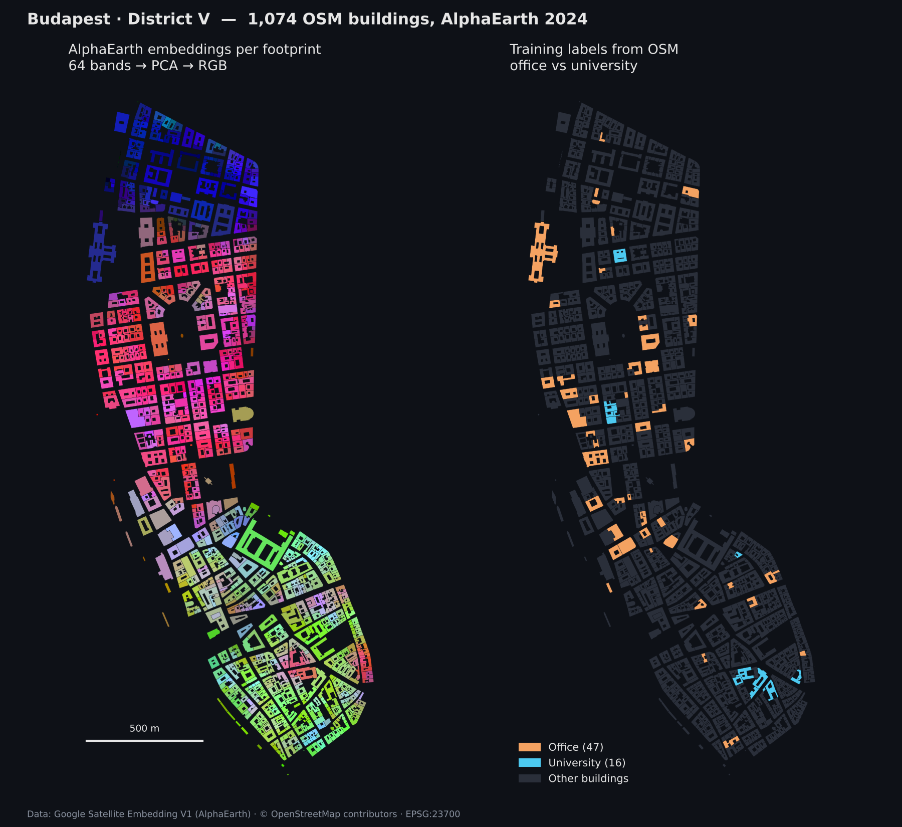
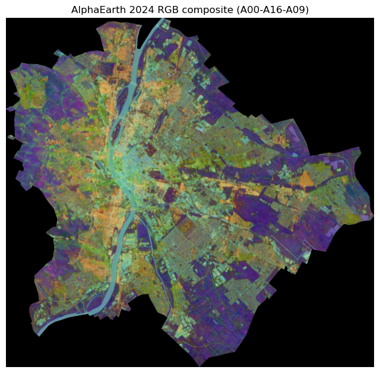

# GeoAI Building Classification

Classifying building types from **Google AlphaEarth satellite embeddings** and **OpenStreetMap** footprints.

The notebook takes building footprints from OSM, attaches 64-dimensional AlphaEarth embedding features to each one, and trains a classifier to tell building types apart. The demo separates **office** buildings from **university** buildings in Budapest's 5th District.



<p align="center">
  <br>
  <em>AlphaEarth 2024 embedding composite of Budapest (bands A00 · A16 · A09)</em>
</p>

## Pipeline

```
OSM footprints ──┐
                 ├──► zonal mean per footprint ──► StandardScaler ──► PCA (10) ──► SVM (RBF)
AlphaEarth 2024 ─┘        (64 bands, 10 m)                                       office vs university
```

1. **AlphaEarth embeddings**: loads `GOOGLE/SATELLITE_EMBEDDING/V1/ANNUAL` from Google Earth Engine, filters it to 2024 and clips it to the Budapest boundary. Bands `A00–A63` are learned 64-D representations of each 10 m pixel.
2. **Building footprints**: pulls `building=*` features for *5th District, Budapest* with OSMnx, keeps only polygons and removes duplicates. This gives **1,074 buildings**.
3. **Feature extraction**: runs `reduceRegions` with a mean reducer at 10 m scale, in batches of 100, to get one 64-band embedding vector per footprint. The results are visualised per band on an interactive Folium map.
4. **Classification**:
   - selects the `office` (47) and `university` (16) buildings, **63 samples** in total
   - standardises the features and applies PCA with 10 components, which keep **94.15%** of the variance (an elbow plot is included)
   - balances the classes with `RandomOverSampler`
   - trains an RBF-kernel SVM on a 70/30 stratified split

## Results

| Class | Precision | Recall | F1 |
|---|---|---|---|
| University (0) | 0.81 | 0.87 | 0.84 |
| Office (1) | 0.85 | 0.79 | 0.81 |
| **Accuracy** | | | **0.83** |

## Tech stack

`earthengine-api` · `geopandas` · `osmnx` · `shapely` · `folium` · `scikit-learn` · `imbalanced-learn` · `numpy` · `pandas` · `matplotlib` · `Pillow`

## Setup

```bash
conda create -n project_geoAI python=3.10 -y
conda activate project_geoAI
conda install -c conda-forge geopandas osmnx folium scikit-learn imbalanced-learn matplotlib pillow jupyter -y
pip install earthengine-api
```

Authenticate with Earth Engine, then open the notebook:

```bash
earthengine authenticate
jupyter notebook buildingClassification.ipynb
```

> Change `ee.Initialize(project=...)` to your own Google Cloud project ID.

## Limitations & next steps

- **Small sample size**: 63 buildings, of which only 16 are universities. The scores are indicative and not a robust benchmark.
- **Possible leakage**: oversampling, scaling and PCA all run *before* the train/test split, so duplicated minority samples can end up in both sets. The next version should split first and put the scaler, PCA, oversampler and SVM in an `imblearn.Pipeline` evaluated with stratified k-fold cross-validation.
- **Coarse resolution relative to buildings**: AlphaEarth pixels are 10 m, so small footprints only cover a few pixels and their averages are mixed with neighbouring surfaces.
- **Planned extensions**: multi-class prediction (apartments, offices, public, hotels, …), predicting the 184 buildings that OSM only tags as `building=yes`, and testing on other cities.

## Data sources

- [Google Satellite Embedding V1 (AlphaEarth Foundations)](https://developers.google.com/earth-engine/datasets/catalog/GOOGLE_SATELLITE_EMBEDDING_V1_ANNUAL)
- [OpenStreetMap](https://www.openstreetmap.org/) via [OSMnx](https://github.com/gboeing/osmnx). © OpenStreetMap contributors, ODbL.
